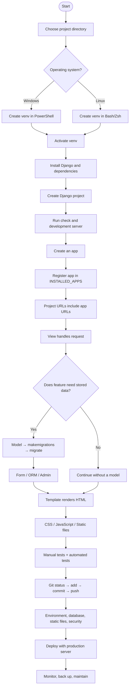
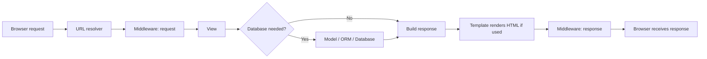
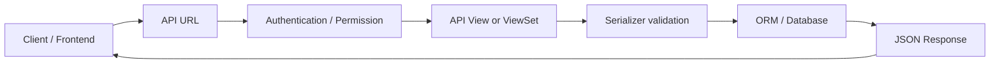
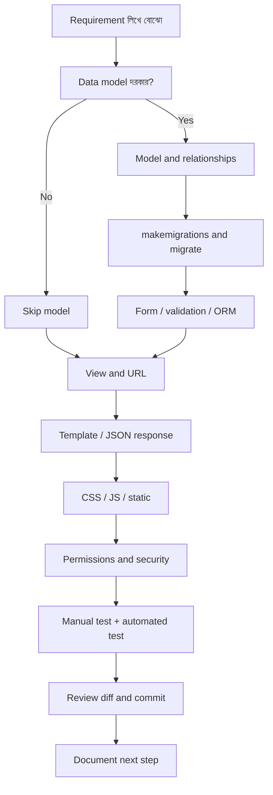

# Django Master Flowchart & Handbook

## বাংলা ব্যাখ্যা + English Technical Terms \| Windows PowerShell + Linux Bash/Zsh

**উদ্দেশ্য:** Django project শুরু করা থেকে structure বোঝা, feature তৈরি,
debugging, testing, Git এবং production deployment-এর প্রস্তুতি---সবকিছুর জন্য
একটি editable learning reference।

> **কীভাবে ব্যবহার করবে** - Code, commands, filenames, class/function
> names এবং standard technical terms English-এ থাকবে। - প্রতিটি গুরুত্বপূর্ণ
> বিষয় সহজ বাংলায় ব্যাখ্যা করা হয়েছে। - Windows commands শুধু **PowerShell**
> section-এ এবং Linux commands **Bash/Zsh** section-এ দেওয়া হয়েছে। -
> সাধারণত `python manage.py ...` command চালাবে সেই directory থেকে,
> যেখানে `manage.py` আছে। - `myproject`, `myapp`, `myuser` ইত্যাদি
> example name নিজের project অনুযায়ী বদলাবে। - Django ও
> `django-tailwind`-এর command version অনুযায়ী বদলাতে পারে; নিজের
> installed version যাচাই করবে।

------------------------------------------------------------------------

# Contents --- এই guide-এ কী আছে?

1.  [Django project-এর complete flowchart](#1-complete-flowchart)
2.  [Django কী এবং Project বনাম App](#2-django-project-vs-app)
3.  [Folder layout ও গুরুত্বপূর্ণ path rule](#3-folder-layout)
4.  [Windows PowerShell setup](#4-windows-powershell)
5.  [Linux Bash/Zsh setup](#5-linux-bashzsh)
6.  [প্রতিটি command কী করে](#6-command-reference)
7.  [Project ও app file structure](#7-project-structure)
8.  [Settings, apps, middleware ও request
    lifecycle](#8-settings-and-request-lifecycle)
9.  [URL → View → Template → Response](#9-url-view-template-response)
10. [HTML, CSS, JavaScript, images ও static files](#10-static-files)
11. [Tailwind CSS / DaisyUI](#11-tailwind-css--daisyui)
12. [Models, ORM, migrations ও
    database](#12-models-orm-migrations-database)
13. [Django Admin, shell, fixtures ও database
    backup](#13-admin-shell-fixtures-backup)
14. [Forms, validation, CRUD ও messages](#14-forms-validation-crud)
15. [Authentication, authorization, sessions &
    CSRF](#15-authentication-permissions-sessions-csrf)
16. [Media uploads, pagination, search ও email](#16-common-web-features)
17. [Testing, debugging ও common
    errors](#17-testing-debugging-common-errors)
18. [Git / GitHub workflow](#18-git-github)
19. [Environment variables, settings split ও
    security](#19-environment-and-security)
20. [REST API---optional next step](#20-rest-api)
21. [Deployment & production checklist](#21-deployment)
22. [End-to-end feature workflow](#22-feature-workflow)
23. [Final checklist, glossary ও personal notes](#23-final-checklist)

------------------------------------------------------------------------

# 1. Complete flowchart



## Request-response flow



**সহজভাবে:** Browser URL-এ request পাঠায় → Django URL মিলিয়ে View বেছে
নেয় → View প্রয়োজন হলে database থেকে data আনে → Template দিয়ে HTML তৈরি
করে → response browser-এ ফেরত যায়। Middleware request/response-এর
মাঝখানে অতিরিক্ত কাজ করতে পারে।

------------------------------------------------------------------------

# 2. Django Project vs App

-   **Django project:** পুরো website/application-এর configuration এবং
    root URL setup। যেমন `config/`, `settings.py`, root `urls.py`।
-   **Django app:** নির্দিষ্ট feature বা business area। যেমন `students`,
    `accounts`, `notices`, `products`।
-   একটি project-এ একাধিক app থাকতে পারে।
-   App তৈরি করলেই সবসময় auto-register হয় না; সাধারণত `INSTALLED_APPS`-এ
    যোগ করতে হয়।
-   `startapp` সাধারণত app-এর `urls.py` তৈরি করে না---এটি নিজে তৈরি
    করবে।

**উদাহরণ:** College management project-এ `students`, `teachers`,
`attendance`, `notices` আলাদা app হতে পারে। ছোট practice project-এ সব
feature আলাদা app করতেই হবে এমন নয়; logical boundary অনুযায়ী ভাগ করবে।

------------------------------------------------------------------------

# 3. Folder layout

একটি common layout:

``` text
myproject-work/
├── .venv/                      # Virtual environment; Git-এ commit নয়
├── .env                        # Local secrets; Git-এ commit নয়
├── requirements.txt            # Python dependencies
├── .gitignore
└── myproject/                  # Django root
    ├── manage.py               # Django command entry point
    ├── db.sqlite3              # SQLite DB; migrations-এর পরে তৈরি হতে পারে
    ├── config/                 # Project configuration package
    │   ├── __init__.py
    │   ├── settings.py
    │   ├── urls.py
    │   ├── asgi.py
    │   └── wsgi.py
    └── myapp/
        ├── __init__.py
        ├── admin.py
        ├── apps.py
        ├── models.py
        ├── tests.py
        ├── views.py
        ├── urls.py             # নিজে তৈরি করবে
        ├── migrations/
        ├── templates/myapp/
        └── static/myapp/
```

**গুরুত্বপূর্ণ path rule** - **Project root:** `manage.py` যে directory-তে
আছে। - **Parent/work directory:** যেখানে `.venv`, project folder,
documentation ইত্যাদি রাখা হয়। - Terminal-এ `pwd` (Linux) বা
`Get-Location` (PowerShell) দিয়ে current directory দেখবে। - `manage.py`
না পাওয়া গেলে প্রথমে current directory ভুল কি না দেখবে; অন্য directory থেকে
command চালালে path error আসতে পারে।

------------------------------------------------------------------------

# 4. Windows PowerShell

## 4.1 New project: parent directory থেকে শুরু

PowerShell খুলে:

``` powershell
# 1. Working directory তৈরি এবং সেখানে যাওয়া
New-Item -ItemType Directory -Force "$HOME\Code\django-learning"
Set-Location "$HOME\Code\django-learning"

# 2. Python launcher/version যাচাই
py --version
py -m pip --version

# 3. Virtual environment তৈরি
py -m venv .venv

# 4. এই terminal-এ activate
.\.venv\Scripts\Activate.ps1

# যদি activation policy block করে, শুধু current process-এর জন্য:
# Set-ExecutionPolicy -Scope Process -ExecutionPolicy Bypass
# তারপর activation command আবার চালাও।

# 5. pip update এবং Django install
python -m pip install --upgrade pip
python -m pip install django

# 6. Version যাচাই
python -m django --version

# 7. Project তৈরি
django-admin startproject config myproject
Set-Location .\myproject

# 8. Configuration check এবং server run
python manage.py check
python manage.py runserver
```

Browser-এ `http://127.0.0.1:8000/` খুলো। Server বন্ধ করতে `Ctrl+C` চাপো।

`django-admin startproject config myproject` ব্যবহার করলে `myproject/`
directory-র ভেতরে `manage.py` এবং `config/` configuration package তৈরি
হবে। চাইলে `django-admin startproject myproject`-এর default layout-ও
ব্যবহার করতে পারো; দুই layout এক project-এ মিশিয়ে ফেলবে না।

## 4.2 App তৈরি

Server বন্ধ করে, `manage.py`-এর directory-তে:

``` powershell
python manage.py startapp myapp
```

তারপর `config/settings.py`-এর `INSTALLED_APPS` list-এ `"myapp"` যোগ করো।

## 4.3 Existing project খুলে চালানো

যদি `.venv` এবং `mysite` একই parent folder-এ থাকে:

``` text
Code\Try\new\
├── .venv\
└── mysite\
    └── manage.py
```

তাহলে:

``` powershell
Set-Location "$HOME\Code\Try\new"
.\.venv\Scripts\Activate.ps1
Set-Location .\mysite
python manage.py check
python manage.py runserver
```

## 4.4 Useful PowerShell commands

``` powershell
Get-Location
Get-ChildItem
Get-Command python
python --version
python -m pip --version
python -m pip install -r requirements.txt
python -m pip freeze | Out-File -Encoding utf8 requirements.txt
deactivate
```

-   `Get-Location`: বর্তমান directory।
-   `Get-ChildItem`: folder/file list।
-   `Get-Command python`: কোন Python executable ব্যবহার হচ্ছে।
-   `deactivate`: virtual environment থেকে বের হওয়া।

------------------------------------------------------------------------

# 5. Linux Bash/Zsh (Arch Linux, Ubuntu ইত্যাদি)

## 5.1 New project

``` bash
# 1. Working directory তৈরি এবং সেখানে যাওয়া
mkdir -p ~/Code/django-learning
cd ~/Code/django-learning

# 2. Python যাচাই
python --version
which python

# 3. Virtual environment তৈরি ও activate
python -m venv .venv
source .venv/bin/activate

# 4. pip update ও Django install
python -m pip install --upgrade pip
python -m pip install django
python -m django --version

# 5. Project তৈরি
django-admin startproject config myproject
cd myproject

# 6. Check ও server
python manage.py check
python manage.py runserver
```

Browser: `http://127.0.0.1:8000/`; server বন্ধ করতে `Ctrl+C`।

Arch Linux-এ সাধারণত `python -m venv .venv` কাজ করে। যদি venv creation
error হয়, error message দেখে distribution-এর Python/venv package
requirement যাচাই করবে। Externally managed system Python-এ global
`pip install` না করে project-এর virtual environment ব্যবহার করবে।

## 5.2 App তৈরি

``` bash
python manage.py startapp myapp
```

## 5.3 Existing project চালানো

যদি `.venv` এবং `mysite` sibling folder হয়:

``` text
~/Code/Try/new/
├── .venv/
└── mysite/
    └── manage.py
```

``` bash
cd ~/Code/Try/new
source .venv/bin/activate
cd mysite
python manage.py check
python manage.py runserver
```

## 5.4 Useful Linux commands

``` bash
pwd
ls -la
which python
python --version
python -m pip --version
python -m pip install -r requirements.txt
python -m pip freeze > requirements.txt
deactivate
```

-   `pwd`: বর্তমান directory।
-   `ls -la`: file/folder list, hidden files-সহ।
-   `which python`: active Python executable path।
-   `deactivate`: virtual environment থেকে বের হওয়া।

------------------------------------------------------------------------

# 6. Command reference --- কোন command কী করে?

  ---------------------------------------------------------------------------------------
  Command                                             কাজ
  --------------------------------------------------- -----------------------------------
  `python -m venv .venv`                              আলাদা Python environment তৈরি

  `python -m pip install django`                      active environment-এ Django install

  `python -m django --version`                        Django version দেখায়

  `django-admin startproject config myproject`        project root ও configuration
                                                      package তৈরি

  `python manage.py startapp myapp`                   নতুন app-এর starter files তৈরি

  `python manage.py check`                            সাধারণ Django configuration issue
                                                      খোঁজে

  `python manage.py runserver`                        local development server চালায়

  `python manage.py makemigrations`                   model change থেকে migration file
                                                      তৈরি

  `python manage.py migrate`                          migration database-এ apply করে

  `python manage.py showmigrations`                   migration status দেখায়

  `python manage.py createsuperuser`                  admin user তৈরি

  `python manage.py shell`                            Django-configured Python shell

  `python manage.py test`                             automated tests চালায়

  `python manage.py findstatic myapp/css/style.css`   Django static file কোথায় খুঁজে পায়
                                                      দেখায়

  `python manage.py collectstatic`                    deployment-এর জন্য static assets এক
                                                      জায়গায় সংগ্রহ করে

  `python manage.py check --deploy`                   deployment/security
                                                      configuration-এর warning দেখায়

  `python -m pip list`                                installed package list

  `python -m pip freeze`                              package/version list

  `git status`                                        working tree এবং staged changes

  `git add .`                                         current tree-র changes staging-এ
                                                      যোগ

  `git commit -m "message"`                           local commit তৈরি

  `git log --oneline -5`                              সাম্প্রতিক ৫টি commit দেখায়

  `git push`                                          configured remote-এ commit পাঠায়
  ---------------------------------------------------------------------------------------

**মনে রাখবে:** `makemigrations` এবং `migrate` এক জিনিস নয়। প্রথমটি
migration file তৈরি করে; দ্বিতীয়টি database schema পরিবর্তন করে।

------------------------------------------------------------------------

# 7. Project structure --- প্রতিটি file/folder-এর দায়িত্ব

``` text
myproject/
├── manage.py
├── config/
│   ├── __init__.py
│   ├── settings.py
│   ├── urls.py
│   ├── asgi.py
│   └── wsgi.py
├── myapp/
│   ├── __init__.py
│   ├── admin.py
│   ├── apps.py
│   ├── models.py
│   ├── views.py
│   ├── tests.py
│   ├── urls.py
│   ├── forms.py               # সাধারণত নিজে তৈরি করবে
│   ├── migrations/
│   ├── templates/myapp/
│   │   └── home.html
│   └── static/myapp/
│       ├── css/style.css
│       ├── js/scripts.js
│       └── images/
├── templates/                 # optional project-level templates
├── static/                    # optional project-level static assets
├── media/                     # local uploaded files; production storage আলাদা হতে পারে
├── requirements.txt
├── .env                       # local secrets; commit নয়
├── .gitignore
└── README.md
```

  -----------------------------------------------------------------------
  File/folder                         দায়িত্ব
  ----------------------------------- -----------------------------------
  `manage.py`                         Django management command চালানোর
                                      entry point

  `settings.py`                       Installed apps, middleware,
                                      database, templates, static,
                                      security configuration

  Project `urls.py`                   Root URL patterns; app URL include
                                      করে

  App `urls.py`                       App-এর path-কে view-এর সঙ্গে যুক্ত
                                      করে; সাধারণত manually তৈরি

  `views.py`                          Request process করে এবং
                                      response/HTML/JSON/redirect ফেরত
                                      দেয়

  `models.py`                         Database model, field ও
                                      relationships

  `admin.py`                          Django admin-এ model
                                      register/configure করে

  `apps.py`                           App configuration

  `migrations/`                       Database schema change-এর history

  `templates/`                        HTML templates; সাধারণত app
                                      namespace রাখা ভালো

  `static/`                           CSS, JavaScript, images, fonts-এর
                                      মতো version-controlled assets

  `media/`                            User-uploaded files; static
                                      files-এর সঙ্গে এক নয়

  `forms.py`                          Form field, validation, ModelForm

  `tests.py` / `tests/`               Automated tests

  `asgi.py`                           ASGI deployment entry point

  `wsgi.py`                           WSGI deployment entry point

  `db.sqlite3`                        SQLite database file; migrations-এর
                                      আগে নাও থাকতে পারে

  `.venv/`                            Isolated Python environment; Git-এ
                                      রাখবে না

  `requirements.txt`                  Python dependency/version list

  `.env`                              Local environment values/secrets;
                                      Git-এ commit করবে না

  `.gitignore`                        Git থেকে নির্দিষ্ট local files বাদ
                                      দেয়

  `README.md`                         Project purpose, setup ও usage
                                      documentation
  -----------------------------------------------------------------------

`forms.py`, project-level `templates/`, `static/`, `media/`,
`requirements.txt`, `.env` সবই `startproject` বা `startapp` দিয়ে
auto-create হয় না---প্রয়োজন অনুযায়ী নিজে তৈরি করবে।

------------------------------------------------------------------------

# 8. Settings, apps, middleware ও request lifecycle

## `settings.py`-তে কী থাকে?

-   `INSTALLED_APPS`: Django built-in এবং নিজের apps।
-   `MIDDLEWARE`: request/response-এর মাঝখানে চলা components।
-   `ROOT_URLCONF`: root URL configuration module।
-   `TEMPLATES`: template engine ও template discovery settings।
-   `DATABASES`: database connection configuration।
-   `STATIC_URL`, `STATICFILES_DIRS`, `STATIC_ROOT`: static asset
    configuration।
-   `MEDIA_URL`, `MEDIA_ROOT`: uploaded media configuration।
-   `AUTH_USER_MODEL`: custom user model থাকলে project-এর শুরুতেই ঠিক করা
    সবচেয়ে সহজ।
-   `DEBUG`, `ALLOWED_HOSTS`, `SECRET_KEY`: deployment-এ নিরাপদভাবে
    configure করতে হবে।

**App register example** --- `config/settings.py`:

``` python
INSTALLED_APPS = [
    # Django built-in apps...
    "myapp",
]
```

যদি `apps.py`-তে custom `AppConfig` ব্যবহার করো, app-এর actual config
path ব্যবহার করতে পারো। একই app duplicate করে যোগ করবে না।

**Middleware:** যেমন session, authentication, CSRF protection, security
headers। Middleware order গুরুত্বপূর্ণ; default list অকারণে remove/reorder
করবে না।

------------------------------------------------------------------------

# 9. URL → View → Template → Response

## Step 1 --- App URL file তৈরি

`myapp/urls.py`:

``` python
from django.urls import path
from . import views

app_name = "myapp"

urlpatterns = [
    path("", views.home, name="home"),
]
```

`app_name` URL namespace দিতে সাহায্য করে। একাধিক app-এ একই নামের URL
থাকলে reverse lookup সহজ হয়।

## Step 2 --- View তৈরি

`myapp/views.py`:

``` python
from django.shortcuts import render

def home(request):
    context = {
        "page_title": "Home",
        "message": "Hello Django!",
    }
    return render(request, "myapp/home.html", context)
```

View-এ request object পাওয়া যায়। View HTML render, redirect, JSON
response অথবা অন্য HTTP response দিতে পারে। Business logic খুব বড় হলে
helper/service module-এ ভাগ করা যেতে পারে।

## Step 3 --- Template তৈরি

`myapp/templates/myapp/home.html`:

``` html
<!doctype html>
<html lang="en">
<head>
    <meta charset="utf-8">
    <meta name="viewport" content="width=device-width, initial-scale=1">
    <title>{{ page_title }}</title>
</head>
<body>
    <h1>{{ message }}</h1>
</body>
</html>
```

`{{ variable }}` দিয়ে context value দেখানো হয়; `` দিয়ে template
tag/control flow লেখা হয়।

## Step 4 --- Project URL-এ app include

`config/urls.py`:

``` python
from django.contrib import admin
from django.urls import include, path

urlpatterns = [
    path("admin/", admin.site.urls),
    path("", include("myapp.urls")),
]
```

এখন `/` path `myapp.views.home`-এ যাবে।

## Named URL ব্যবহার

Template-এ:

``` html
<a href="">Home</a>
```

Hard-code করা URL-এর বদলে named URL ব্যবহার করলে path বদলালেও template-এ
কম পরিবর্তন লাগে।

------------------------------------------------------------------------

# 10. HTML, CSS, JavaScript, images ও static files

## Recommended app-level static structure

``` text
myapp/
└── static/
    └── myapp/
        ├── css/style.css
        ├── js/scripts.js
        └── images/logo.png
```

`settings.py`-তে `django.contrib.staticfiles` সাধারণত default
`INSTALLED_APPS`-এ থাকে। `STATIC_URL`:

``` python
STATIC_URL = "static/"
```

`STATIC_URL` URL prefix, filesystem path নয়।
`STATIC_URL = "../firstApp/static/"`-এর মতো relative filesystem path
ব্যবহার করবে না।

## Template-এ static files load

``` html

<!doctype html>
<html lang="en">
<head>
    <meta charset="utf-8">
    <meta name="viewport" content="width=device-width, initial-scale=1">
    <title>My page</title>
    <link rel="stylesheet" href="">
    <script src="" defer></script>
</head>
<body>
    <h1 class="page-title">Hello Django</h1>
    <button id="hello-button" type="button">Click me</button>
</body>
</html>
```

`myapp/css/style.css`:

``` css
.page-title {
    color: rebeccapurple;
    padding: 1rem;
}
```

`myapp/js/scripts.js`:

``` javascript
document.addEventListener("DOMContentLoaded", () => {
    const button = document.querySelector("#hello-button");

    if (button) {
        button.addEventListener("click", () => {
            alert("JavaScript is working!");
        });
    }
});
```

## Static troubleshooting

Run from `manage.py` directory:

``` bash
python manage.py findstatic myapp/css/style.css
python manage.py findstatic myapp/js/scripts.js
python manage.py check
```

এই commands PowerShell-এও একই।

-   Browser DevTools → **Network**: CSS/JS request status দেখো। `404`
    মানে file URL/path খুঁজে পাওয়া যায়নি।
-   **Console**: JavaScript errors দেখো।
-   `Ctrl+Shift+R`: hard refresh।
-   `` আছে কি না দেখো।
-   File path ও template-এর `` path
    character-by-character মিলিয়ে দেখো।
-   CSS rule কাজ না করলে cascade, specificity, source order এবং browser
    cache দেখো।
-   `STATICFILES_DIRS` সাধারণত project-level extra `static/`
    directory-এর জন্য; app-এর `app/static/app/...` files-এর জন্য সাধারণত
    লাগে না।

**Static বনাম Media** - **Static:** developer-maintained
CSS/JS/icons/images। - **Media:** user-uploaded profile photos,
documents ইত্যাদি। Production-এ media storage ও access policy আলাদা করে
configure করতে হবে।

------------------------------------------------------------------------

# 11. Tailwind CSS / DaisyUI

Tailwind class HTML-এ লিখলেই CSS file তৈরি হয়ে যায় না; compiler/build
step চালাতে হয়। `django-tailwind`-এর version এবং setup option
(Standalone v4, Full v4, legacy v3) অনুযায়ী commands ও template tags
আলাদা হতে পারে। এক version-এর নির্দেশনা অন্য version-এ অন্ধভাবে প্রয়োগ করবে
না।

## Setup checklist

1.  Active virtual environment-এ প্রয়োজনীয় package install করো।
2.  Installed `django-tailwind` version যাচাই করো।
3.  Generated theme app-এর নাম `INSTALLED_APPS`-এ আছে কি না দেখো।
4.  `TAILWIND_APP_NAME` generated theme app-এর নামের সঙ্গে মেলে কি না
    যাচাই করো।
5.  Template-এ installed version-এর উপযুক্ত Tailwind template tag ব্যবহার
    করো।
6.  Compiler/watch process চালু আছে কি না নিশ্চিত করো।
7.  Template files Tailwind scan/content source-এর মধ্যে আছে কি না দেখো।
8.  Compiled CSS path এবং browser Network tab পরীক্ষা করো।
9.  DaisyUI ব্যবহার করলে সেটি সঠিকভাবে configure/plugin হিসেবে যুক্ত আছে কি
    না দেখো।

Useful checks:

``` bash
python -m pip show django-tailwind
python manage.py tailwind --help
python manage.py findstatic css/dist/styles.css
```

PowerShell-এও commands একই। সব setup-এ `python manage.py tailwind start`
বা একই template tag কাজ করবে---এমন নিশ্চয়তা নেই; আগে `--help` ও installed
version দেখবে।

## Tailwind + custom CSS

Tailwind এবং নিজের `style.css` একসঙ্গে ব্যবহার করা যায়। একই CSS property
দুটো জায়গায় set হলে cascade, specificity এবং source order ঠিক করে কোন
rule কার্যকর হবে। একবারে এক stylesheet disable করে test করলে conflict
খুঁজতে সুবিধা হয়। `!important` দিয়ে সব conflict ঢেকে না রেখে root cause ঠিক
করো।

------------------------------------------------------------------------

# 12. Models, ORM, migrations ও database

## Model example --- `myapp/models.py`

``` python
from django.db import models

class Task(models.Model):
    title = models.CharField(max_length=200)
    is_done = models.BooleanField(default=False)
    created_at = models.DateTimeField(auto_now_add=True)

    def __str__(self):
        return self.title
```

-   `models.Model` থেকে inherit করলে Django model তৈরি হয়।
-   `CharField` text field; `max_length` লাগে।
-   `BooleanField` true/false value রাখে।
-   `auto_now_add=True` object প্রথম তৈরি হওয়ার সময় timestamp বসায়।
-   `__str__()` admin/debug output-এ readable label দেয়।

## Migration cycle

``` bash
python manage.py makemigrations
python manage.py showmigrations
python manage.py migrate
```

Flow: `models.py` edit → `makemigrations` → migration file inspect →
`migrate` → test।

-   Migration file হলো schema changes-এর version history।
-   Migration delete/edit করার আগে বুঝতে হবে database-এ apply হয়েছে কি
    না; shared/production project-এ casual edit করবে না।
-   অন্যের project clone করলে সাধারণত dependencies install করে `migrate`
    চালাতে হয়।
-   Model-এর field change হলে migration status ও data impact যাচাই করো।

## ORM basics --- Django shell-এ

``` python
from myapp.models import Task

Task.objects.create(title="Learn ORM")

Task.objects.all()
Task.objects.filter(is_done=False)
Task.objects.get(pk=1)

task = Task.objects.get(pk=1)
task.is_done = True
task.save()

Task.objects.filter(pk=1).delete()
```

`get()` একটিমাত্র result আশা করে; object না থাকলে `DoesNotExist`, একাধিক
হলে `MultipleObjectsReturned` হতে পারে। User input দিয়ে database query
তৈরি করলে Django ORM-এর parameterized/query-building পদ্ধতি ব্যবহার করবে;
raw SQL দরকার না হলে এড়িয়ে চলবে।

## Relationships

``` python
from django.db import models

class Category(models.Model):
    name = models.CharField(max_length=100)

class Product(models.Model):
    category = models.ForeignKey(
        Category,
        on_delete=models.PROTECT,
        related_name="products",
    )
    name = models.CharField(max_length=150)
```

-   `ForeignKey`: many-to-one relationship।
-   `ManyToManyField`: many-to-many relationship।
-   `OneToOneField`: one-to-one relationship।
-   `on_delete` behaviour বুঝে বেছে নাও; সব ক্ষেত্রে `CASCADE` সঠিক নয়।

## Database choice

-   **SQLite:** শেখা, local practice এবং ছোট prototype-এর জন্য সহজ।
-   **PostgreSQL:** production এবং relational application-এর জন্য বহুল
    ব্যবহৃত choice।
-   Database change করলে connection settings, driver, credentials,
    migrations এবং backup/restore procedure যাচাই করতে হবে।

------------------------------------------------------------------------

# 13. Django Admin, shell, fixtures ও backup

## Admin register --- `myapp/admin.py`

``` python
from django.contrib import admin
from .models import Task

@admin.register(Task)
class TaskAdmin(admin.ModelAdmin):
    list_display = ("id", "title", "is_done", "created_at")
    list_filter = ("is_done",)
    search_fields = ("title",)
```

তারপর:

``` bash
python manage.py createsuperuser
python manage.py runserver
```

Browser-এ `/admin/` খুলে superuser credentials দিয়ে login করো।

## Useful management commands

``` bash
python manage.py shell
python manage.py dbshell
python manage.py dumpdata myapp --indent 2
python manage.py loaddata fixture.json
python manage.py showmigrations
```

-   `shell`: Django environment-সহ Python shell।
-   `dbshell`: database CLI; database client installed/configured থাকতে
    পারে।
-   `dumpdata`: Django model data fixture হিসেবে export করতে পারে।
-   `loaddata`: fixture data load করে; আগে target database বুঝে নেবে।
-   Fixture export সবসময় পূর্ণাঙ্গ production backup-এর বিকল্প নয়।

**Backup:** Production database-এর জন্য database-specific backup/restore
method ব্যবহার করবে, backup file নিরাপদে রাখবে এবং restore test করবে। শুধু
`db.sqlite3` copy করা সব database system-এর জন্য প্রযোজ্য নয়।

------------------------------------------------------------------------

# 14. Forms, validation, CRUD ও messages

CRUD মানে **Create, Read, Update, Delete**---বেশিরভাগ data-driven
feature-এর মৌলিক workflow।

## ModelForm example --- `myapp/forms.py`

``` python
from django import forms
from .models import Task

class TaskForm(forms.ModelForm):
    class Meta:
        model = Task
        fields = ["title", "is_done"]
```

## Create view example

``` python
from django.shortcuts import redirect, render
from .forms import TaskForm

def task_create(request):
    if request.method == "POST":
        form = TaskForm(request.POST)
        if form.is_valid():
            form.save()
            return redirect("myapp:home")
    else:
        form = TaskForm()

    return render(request, "myapp/task_form.html", {"form": form})
```

Template example:

``` html
<form method="post">
    
    {{ form.as_p }}
    <button type="submit">Save</button>
</form>
```

-   GET সাধারণত form/page দেখায়।
-   POST form data পাঠায়।
-   `is_valid()` server-side validation চালায়।
-   `form.save()` valid ModelForm data database-এ save করে।
-   Successful POST-এর পরে redirect করা সাধারণ pattern; refresh করলে
    duplicate submission-এর ঝুঁকি কমে।

**Validation:** Browser-side validation user experience-এর জন্য ভালো,
কিন্তু security/business rules-এর জন্য server-side validation আবশ্যক।
User-এর দেওয়া ID/owner/role অন্ধভাবে বিশ্বাস করবে না।

**Django messages:** সফল save, warning বা error feedback দেখাতে messages
framework ব্যবহার করা যায়; app settings-এ default messages support
সাধারণত থাকে।

------------------------------------------------------------------------

# 15. Authentication, permissions, sessions ও CSRF

-   **Authentication:** user কে---login/logout ও identity verification।
-   **Authorization:** user কী করতে পারবে---permissions/roles।
-   **Session:** server-side state-এর সঙ্গে user-কে যুক্ত রাখার mechanism।
-   **CSRF protection:** authenticated browser session ব্যবহার করে forged
    request ঠেকাতে সাহায্য করে।
-   **Password:** plain text-এ store করবে না; Django-এর built-in
    authentication/password hashing ব্যবহার করবে।

Common components: - `django.contrib.auth` - `django.contrib.sessions` -
`django.contrib.messages` - `LoginView`, `LogoutView`,
`login_required` - `User`, `Group`, `Permission`

Important practices: 1. Login required page-এ authentication enforce
করো। 2. Sensitive action-এ শুধু login থাকলেই হবে না---permission/ownership
check করো। 3. POST form-এ `` রাখো। 4. CSRF middleware
অকারণে disable করবে না। 5. Login, logout, password reset ও access
control test করো। 6. Custom user model দরকার হলে project-এর শুরুতেই
পরিকল্পনা করো; পরে বদলানো জটিল হতে পারে। 7. User-provided object ID দিয়ে
record load করলে user ওই record access করতে পারে কি না যাচাই করো।

------------------------------------------------------------------------

# 16. Common web features

## File upload

-   Form-এ `enctype="multipart/form-data"` প্রয়োজন।
-   View-এ `request.FILES` এবং ModelForm/form validation ব্যবহার করো।
-   File type/size validation ও access control করো।
-   Uploaded file-কে trusted executable code ধরে নেবে না।
-   `MEDIA_ROOT` ও `MEDIA_URL` development/production-এ আলাদাভাবে
    configure হতে পারে।

## Pagination

বড় list একসঙ্গে render না করে page ভাগ করো। Django-এর `Paginator` কাজে
লাগে; invalid/out-of-range page handling test করো।

## Search & filtering

-   User query validate করো।
-   ORM `filter()` ব্যবহার করো।
-   Search field ও result limit ঠিক রাখো।
-   Permission/tenant boundary থাকলে search-এও সেই restriction enforce
    করো।

## Email

Password reset, notifications ইত্যাদির জন্য email backend/configuration
লাগে। Development-এ console backend ব্যবহার করা যেতে পারে; production-এ
credentials secret হিসেবে রাখো এবং delivery failure handle করো।

## JSON response

API বা JavaScript integration-এর জন্য `JsonResponse` ব্যবহার করা যায়;
response-এ sensitive data expose হচ্ছে কি না যাচাই করো।

------------------------------------------------------------------------

# 17. Testing, debugging ও common errors

## Basic checks

``` bash
python manage.py check
python manage.py test
python manage.py test myapp
python -m pip list
python -m pip freeze
git status
```

Windows PowerShell-এও commands একই।

## Test example --- `myapp/tests.py`

``` python
from django.test import TestCase
from django.urls import reverse

class HomePageTests(TestCase):
    def test_home_page_returns_200(self):
        response = self.client.get(reverse("myapp:home"))
        self.assertEqual(response.status_code, 200)
```

Test চালানোর আগে app URL ও view-তে `name="home"` এবং `app_name="myapp"`
সেট করা আছে কি না নিশ্চিত করো।

## Debugging routine

1.  Traceback-এর শেষ অংশে exception type/message পড়ো।
2.  Traceback-এ দেখানো file ও line খুলে দেখো।
3.  Import, spelling, parentheses, quotes, indentation ও path যাচাই করো।
4.  App `INSTALLED_APPS`-এ আছে কি না দেখো।
5.  Command `manage.py` directory থেকে চালাচ্ছ কি না যাচাই করো।
6.  `python manage.py check` চালাও।
7.  একবারে একটি change করো, আবার test করো।
8.  Secret/token/password traceback বা public repository-তে প্রকাশ করো
    না।

## Common errors

  -----------------------------------------------------------------------
  Error / symptom                     সম্ভাব্য কারণ ও করণীয়
  ----------------------------------- -----------------------------------
  `can't open file ... manage.py`     ভুল directory; `pwd`/`Get-Location`,
                                      `ls`/`Get-ChildItem` দিয়ে path
                                      যাচাই

  `ModuleNotFoundError: django`       ভুল/inactive venv বা Django install
                                      হয়নি; activate করে
                                      `python -m pip show django`

  `No module named 'tailwind'`        package/version/app configuration
                                      যাচাই; installed package-এর guide
                                      অনুসরণ

  `TemplateDoesNotExist`              template path, app registration এবং
                                      `templates/app_name/file.html`
                                      layout যাচাই

  Static CSS/JS `404`                 ``, static path,
                                      app registration, `findstatic` ও
                                      Network tab যাচাই

  `no such table`                     migration apply হয়নি;
                                      `makemigrations`/`migrate` ও
                                      correct database যাচাই

  `OperationalError`                  DB config, database server,
                                      credentials, migrations এবং DB
                                      availability যাচাই

  `CSRF verification failed`          POST form-এ ``,
                                      middleware, origin/proxy
                                      configuration যাচাই

  `DisallowedHost`                    `ALLOWED_HOSTS`-এ request host
                                      configure করা হয়নি

  `NoReverseMatch`                    URL name, namespace, required
                                      arguments এবং URL patterns মিলিয়ে
                                      দেখো

  `ImportError` / circular import     import chain ও module
                                      responsibility যাচাই; imports
                                      অকারণে একে অন্যের ওপর নির্ভরশীল করো
                                      না

  Port already in use                 অন্য server process চলছে; অন্য port-এ
                                      runserver বা আগের process stop করো

  Tailwind class কাজ করছে না          compiler চলছে কি না, content scan,
                                      generated CSS, template tag ও
                                      browser cache যাচাই

  JS কাজ করছে না                      script path/Network status, Console
                                      error, selector ও `defer`/load
                                      timing যাচাই
  -----------------------------------------------------------------------

`show_urls` Django-এর built-in management command নয়; অতিরিক্ত package বা
custom command লাগতে পারে।

## Dependency files

Linux:

``` bash
python -m pip freeze > requirements.txt
python -m pip install -r requirements.txt
```

Windows PowerShell:

``` powershell
python -m pip freeze | Out-File -Encoding utf8 requirements.txt
python -m pip install -r requirements.txt
```

`pip freeze` current environment-এর installed packages তালিকাভুক্ত করে; বড়
project-এ dependencies review ও version pinning দরকার হতে পারে।

------------------------------------------------------------------------

# 18. Git / GitHub workflow

Git repository root-এ চালাও:

``` bash
git status
git add .
git diff --cached
git commit -m "Add task feature"
git log --oneline -5
git push
```

-   `git status`: কোন files modified/untracked/staged তা দেখায়।
-   `git add`: commit-এর জন্য changes stage করে।
-   `git diff --cached`: commit করার আগে staged changes review।
-   `git commit`: local history-তে snapshot।
-   `git push`: configured remote-এ commit পাঠায়।
-   Push rejected হলে আগে error message পড়বে; remote-এ অন্য commit থাকলে
    pull/fetch/reconcile প্রয়োজন হতে পারে। Blind force push করবে না।

## `.gitignore` example

``` gitignore
.venv/
venv/
__pycache__/
*.py[cod]
.env
db.sqlite3
staticfiles/
media/
.idea/
.vscode/
```

Project অনুযায়ী adjust করো। কিছু project-এ media files version control-এ
রাখার policy থাকতে পারে, তবে user uploads সাধারণত Git-এ commit করা হয়
না। Secrets, API keys, production passwords কখনো commit করবে না।

------------------------------------------------------------------------

# 19. Environment variables, settings split ও security

## Secrets

`SECRET_KEY`, database password, email credentials, API keys code-এর
মধ্যে hard-code করবে না। Environment variable বা secret manager ব্যবহার
করো। `.env` file ব্যবহার করলে `.gitignore`-এ রাখবে এবং production
environment-এ নিরাপদভাবে configure করবে।

## Settings split

ছোট learning project-এ একটি `settings.py` যথেষ্ট। বড় project-এ `base.py`,
`development.py`, `production.py` ভাগ করা যেতে পারে---কিন্তু settings
module ঠিকভাবে configure করতে হবে।

## Security checklist

-   `DEBUG = False` in production.
-   Correct `ALLOWED_HOSTS`.
-   HTTPS এবং secure cookies configure করা।
-   CSRF protection চালু রাখা।
-   User input server-side validate করা।
-   Authentication-এর পাশাপাশি permission/ownership enforce করা।
-   Secrets source control-এর বাইরে রাখা।
-   Dependencies update ও vulnerability review করা।
-   Database/media backup এবং access policy ঠিক করা।
-   Error pages/logs-এ secrets expose না করা।

------------------------------------------------------------------------

# 20. REST API --- optional next step

Django দিয়ে HTML-rendered website বানানো যায়; JavaScript/mobile client
বা separate frontend-কে data দিতে REST API-ও তৈরি করা যায়। সাধারণত
Django REST Framework (DRF) ব্যবহার করা হয়।

Typical API flow:



শেখার ক্রম: 1. Django fundamentals, URL/view/template, ORM, forms, auth।
2. HTTP methods/status codes, JSON। 3. DRF serializers, API
views/viewsets, routers। 4. Authentication/permissions, pagination,
filtering। 5. API tests এবং documentation।

HTML website শিখতে DRF বাধ্যতামূলক নয়; project requirement থাকলে শিখবে।

------------------------------------------------------------------------

# 21. Deployment & production checklist

-   [ ] `DEBUG = False`
-   [ ] Correct `ALLOWED_HOSTS`
-   [ ] `SECRET_KEY` এবং credentials environment/secret manager-এ
-   [ ] Production database configured (যেমন PostgreSQL)
-   [ ] Database migration plan এবং tested backup/restore
-   [ ] `python manage.py check --deploy` run এবং warnings review
-   [ ] Static files configuration ও প্রয়োজনমতো `collectstatic`
-   [ ] Uploaded media storage/access configured
-   [ ] HTTPS, secure cookies এবং proxy settings যাচাই
-   [ ] Production-capable WSGI/ASGI server configured
-   [ ] Logs, error monitoring এবং health checks
-   [ ] Dependency versions recorded
-   [ ] Deployment-এর আগে automated tests
-   [ ] Secrets এবং private data repository/logs-এ নেই
-   [ ] Restore/rollback plan আছে

`runserver` development-এর জন্য, production-এর জন্য নয়। `check --deploy`
warning জানায়; এটি নিজে deployment করে না। Deployment process hosting
provider, server stack ও Django version অনুযায়ী আলাদা হতে পারে।

------------------------------------------------------------------------

# 22. Feature development workflow



প্রতিটি feature-এর জন্য নিজেকে জিজ্ঞেস করো: 1. User কী করতে পারবে? 2. কোন
data store হবে? 3. কার access থাকবে? 4. URL ও view কী হবে? 5. Validation
ও error handling কী হবে? 6. কোন test লিখব? 7. Feature কাজ করছে কীভাবে
যাচাই করব?

------------------------------------------------------------------------

# 23. Final checklist, glossary ও personal notes

## Project setup checklist

-   [ ] Working directory তৈরি
-   [ ] Virtual environment তৈরি ও activate
-   [ ] Django install এবং version check
-   [ ] Project তৈরি
-   [ ] `manage.py check` pass
-   [ ] Development server চালানো
-   [ ] App তৈরি এবং `INSTALLED_APPS`-এ register
-   [ ] App `urls.py` তৈরি এবং project URL-এ include
-   [ ] View ও template তৈরি
-   [ ] CSS/JS static files load যাচাই
-   [ ] Tailwind লাগলে installed version অনুযায়ী configure
-   [ ] Models/migrations/database ঠিক করা
-   [ ] Admin configure
-   [ ] Form validation ও permissions যোগ
-   [ ] Automated tests চালানো
-   [ ] `.gitignore`, `requirements.txt`, README তৈরি
-   [ ] Git diff review করে commit
-   [ ] Production checklist review

## Mini glossary

  -----------------------------------------------------------------------
  Term                                সহজ অর্থ
  ----------------------------------- -----------------------------------
  Project                             পুরো Django application-এর
                                      configuration ও root structure

  App                                 নির্দিষ্ট feature/domain-এর code
                                      package

  URL routing                         URL path অনুযায়ী view নির্বাচন

  View                                Request process করে response তৈরি

  Template                            HTML-এর সঙ্গে dynamic data render
                                      করে

  Model                               Database data ও structure define
                                      করে

  ORM                                 Python code দিয়ে database query
                                      করার interface

  Migration                           Database schema changes-এর
                                      versioned record

  Middleware                          Request/response pipeline-এর
                                      অতিরিক্ত processing layer

  Static files                        CSS, JavaScript, fonts ও
                                      developer-maintained images

  Media files                         User-uploaded files

  Authentication                      User identity যাচাই

  Authorization                       User-এর allowed actions/permissions
                                      যাচাই

  CSRF                                Browser session ব্যবহার করে forged
                                      request-এর বিরুদ্ধে protection

  Test                                Code expected behaviour করছে কি না
                                      স্বয়ংক্রিয়ভাবে যাচাই

  Deployment                          App-কে production environment-এ চালু
                                      করা
  -----------------------------------------------------------------------

## My project notes --- নিজের মতো edit করো

-   Project name:
-   Operating system: Windows / Linux
-   Python version:
-   Django version:
-   Virtual environment path:
-   Project root (`manage.py` directory):
-   Apps:
-   Database:
-   Frontend: plain CSS / Tailwind / DaisyUI / other
-   Current step:
-   Next task:
-   Current error:
-   Fix that worked:
-   Tests run:
-   Last updated:

------------------------------------------------------------------------

## Audit notes --- guide update করার সময় যাচাই করা বিষয়

এই guide-এ initial setup ছাড়াও নিচের গুরুত্বপূর্ণ areas যোগ/পরীক্ষা করা হয়েছে:

-   [x] Windows PowerShell ও Linux Bash/Zsh commands আলাদা
-   [x] `manage.py` directory এবং sibling `.venv` layout
-   [x] Project বনাম app এবং manually created `urls.py`
-   [x] File/folder responsibility
-   [x] URL → View → Model/ORM → Template → Response
-   [x] Settings, `INSTALLED_APPS`, middleware
-   [x] Static বনাম media; CSS, JS ও Tailwind troubleshooting
-   [x] Models, relationships, migrations ও ORM
-   [x] Admin, shell, fixtures এবং backup/restore সতর্কতা
-   [x] Forms, CRUD, server-side validation
-   [x] Authentication, permissions, sessions, CSRF
-   [x] Uploads, pagination, search, email, JSON
-   [x] Tests, common errors এবং debugging routine
-   [x] Git, `.gitignore`, dependencies ও secrets
-   [x] Optional REST API path
-   [x] Production/deployment checklist এবং ongoing maintenance

**Version reminder:** Django, Python এবং `django-tailwind`-এর version
অনুযায়ী command/API পরিবর্তিত হতে পারে। নিজের environment-এ
`python -m django --version`, `python -m pip show django-tailwind` এবং
`python manage.py tailwind --help` দিয়ে যাচাই করবে। এই document একটি
learning handbook; production project-এ official documentation ও
hosting-specific deployment instructions অনুসরণ করবে।
